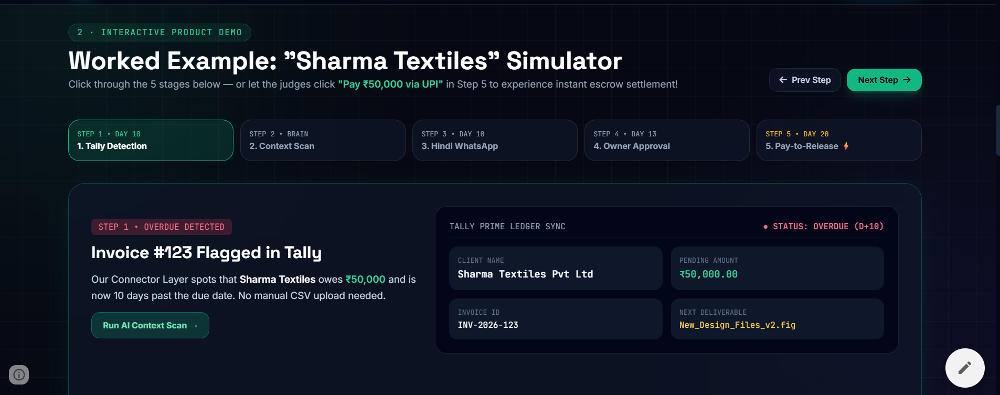
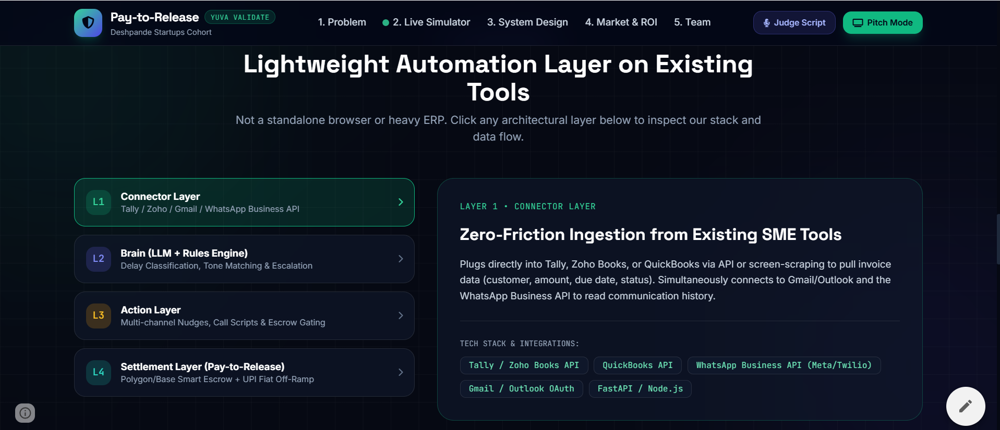

# Pay-to-Release

We don't chase payments. We automate the chase — and enforce the outcome.

Pay-to-Release is a lightweight automation layer on existing tools, designed to simplify payment tracking and collection for small and medium enterprises. It acts as an intelligent middleware, seamlessly integrating with your current accounting and communication platforms.

---

## Features

### 1. Worked Example: "Sharma Textiles" Simulator
Pay-to-Release offers a smooth, multi-step process for chasing delayed payments.
Here's a worked example for an overdue invoice:

* **Step 1: Tally Detection (Day 10)**
  The Connector Layer spots that a client owes money and is now 10 days past the due date. No manual CSV upload needed.
* **Step 2: Context Scan**
  The Brain component scans the context of the invoice and past communications.
* **Step 3: Hindi WhatsApp**
  The system reaches out to the client via WhatsApp in a localized language (e.g., Hindi) to remind them gently but firmly.
* **Step 4: Owner Approval**
  If escalated, the owner can approve further actions.
* **Step 5: Pay-to-Release**
  Instant escrow settlement upon payment.

---

### 2. Lightweight Automation Layer on Existing Tools
Pay-to-Release isn't a standalone browser or heavy ERP. It is an architectural layer that integrates natively with tools you already use, creating a frictionless flow from invoicing to settlement.

#### Architecture Stack

* **Layer 1: Connector Layer (Zero-Friction Ingestion)**
  Plugs directly into Tally, Zoho Books, or QuickBooks via API or screen-scraping to pull invoice data (customer, amount, due date, status). Simultaneously connects to Gmail/Outlook and the WhatsApp Business API to read communication history.
  *Tech Stack: Tally / Zoho Books API, QuickBooks API, WhatsApp Business API (Meta/Twilio), Gmail / Outlook OAuth*
* **Layer 2: Brain (LLM + Rules Engine)**
  Handles delay classification, tone matching, and escalation logic to decide when and how to nudge the client.
* **Layer 3: Action Layer**
  Executes multi-channel nudges, provides call scripts, and manages escrow gating.
* **Layer 4: Settlement Layer (Pay-to-Release)**
  Powered by Polygon/Base Smart Escrow and a UPI Fiat Off-Ramp for instant, verifiable payments.
  *Tech Stack: FastAPI / Node.js*
